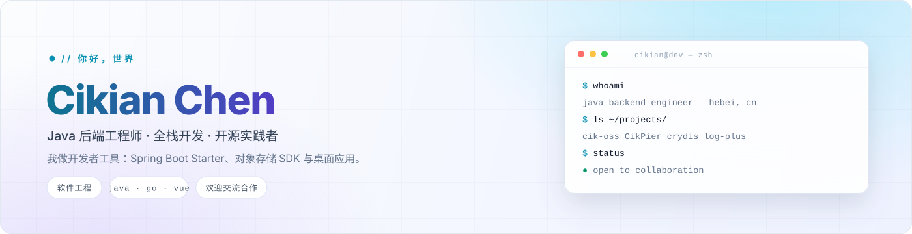
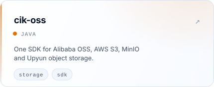
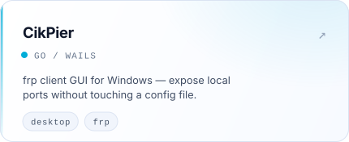
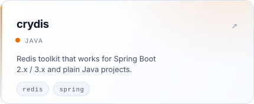
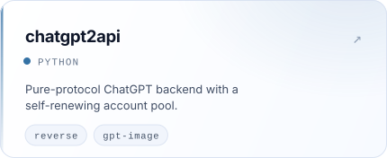
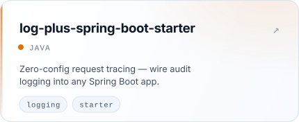
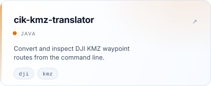
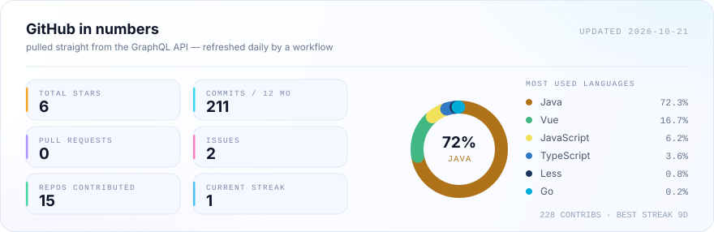

<picture>
  <source media="(prefers-color-scheme: dark)" srcset="assets/hero-dark-zh.svg" />
  <source media="(prefers-color-scheme: light)" srcset="assets/hero-light-zh.svg" />
  
</picture>

 

## 🚀 我在做什么

我自己也在用的项目 —— 对象存储、内网穿透、Redis 工具，以及一点点逆向。

<table>
<tr>
<td width="50%" valign="top">
<a href="https://github.com/Cikian/cik-oss"><picture>
<source media="(prefers-color-scheme: dark)" srcset="assets/proj-01-dark.svg" />
<source media="(prefers-color-scheme: light)" srcset="assets/proj-01-light.svg" />

</picture></a>
</td>
<td width="50%" valign="top">
<a href="https://github.com/Cikian/CikPier"><picture>
<source media="(prefers-color-scheme: dark)" srcset="assets/proj-02-dark.svg" />
<source media="(prefers-color-scheme: light)" srcset="assets/proj-02-light.svg" />

</picture></a>
</td>
</tr>
<tr>
<td width="50%" valign="top">
<a href="https://github.com/Cikian/crydis"><picture>
<source media="(prefers-color-scheme: dark)" srcset="assets/proj-03-dark.svg" />
<source media="(prefers-color-scheme: light)" srcset="assets/proj-03-light.svg" />

</picture></a>
</td>
<td width="50%" valign="top">
<a href="https://github.com/Cikian/chatgpt2api"><picture>
<source media="(prefers-color-scheme: dark)" srcset="assets/proj-04-dark.svg" />
<source media="(prefers-color-scheme: light)" srcset="assets/proj-04-light.svg" />

</picture></a>
</td>
</tr>
<tr>
<td width="50%" valign="top">
<a href="https://github.com/Cikian/log-plus-spring-boot-starter"><picture>
<source media="(prefers-color-scheme: dark)" srcset="assets/proj-05-dark.svg" />
<source media="(prefers-color-scheme: light)" srcset="assets/proj-05-light.svg" />

</picture></a>
</td>
<td width="50%" valign="top">
<a href="https://github.com/Cikian/cik-kmz-translator"><picture>
<source media="(prefers-color-scheme: dark)" srcset="assets/proj-06-dark.svg" />
<source media="(prefers-color-scheme: light)" srcset="assets/proj-06-light.svg" />

</picture></a>
</td>
</tr>
</table>

## 🧰 技术栈

Java 是主场，其余都是「顺手学来却真用上了」的岔路。

**后端**

**前端**

**数据与基础设施**

**工具与编辑器**

## 📈 数据一览

数据实时取自 GraphQL API，每天由 workflow 重绘 —— 不依赖第三方卡片服务，也不会挂图。

<picture>
  <source media="(prefers-color-scheme: dark)" srcset="assets/stats-dark.svg" />
  <source media="(prefers-color-scheme: light)" srcset="assets/stats-light.svg" />
  
</picture>

## 🐍 贡献贪吃蛇

一条每晚重画的蛇，专门吃我的提交格子。

<picture>
  <source media="(prefers-color-scheme: dark)" srcset="https://raw.githubusercontent.com/Cikian/Cikian/output/github-snake-dark.svg" />
  <source media="(prefers-color-scheme: light)" srcset="https://raw.githubusercontent.com/Cikian/Cikian/output/github-snake.svg" />
  
</picture>

## 🤝 打个招呼

河北水利电力学院软件工程专业 · 目前在做后端系统与各种小工具。

